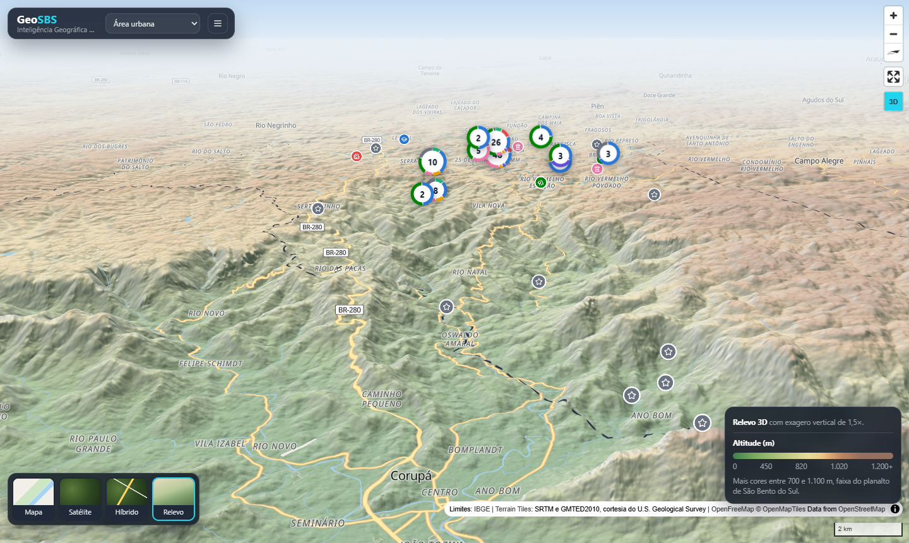

# GeoSBS — Plataforma de Inteligência Geográfica de São Bento do Sul

[](https://github.com/Gustav17a/GeoSBS/actions/workflows/tests.yml)
[](https://gustav17a.github.io/GeoSBS/)

[](LICENSE)

Aplicação em Python que coleta, valida, integra e analisa dados geográficos de
equipamentos urbanos de **São Bento do Sul (SC)** e gera um **mapa interativo**
(MapLibre GL JS) com mapa vetorial, satélite, relevo sombreado e **terreno em 3D com
elevação real**, painel de indicadores, filtros por categoria, agrupamento de
marcadores, mapa de calor e mapas coropléticos por bairro.

**Mapa publicado:** <https://gustav17a.github.io/GeoSBS/>

> Trabalho acadêmico da disciplina de Geolocalização — Bacharelado em Sistemas de
> Informação, UDESC.




## O que o sistema faz

| Etapa | Descrição | Módulo |
|---|---|---|
| Coleta | Malha Municipal 2025, Malha de Bairros e população do Censo 2022 (IBGE); pontos de interesse do OpenStreetMap (uma consulta Overpass, com cache); unidades públicas de saúde do CNES (Ministério da Saúde) para comparação | `src/data_collection` |
| Processamento | Esquema padronizado, classificação em 8 categorias, validação de coordenadas, recorte pelo limite municipal, flags de dados ausentes, remoção de duplicatas | `src/data_processing` |
| Geoprocessamento | Reprojeção (SIRGAS 2000 → UTM 22S / WGS 84), áreas em km², junção espacial ponto-em-polígono, geocodificação com Geopy/Nominatim | `src/geospatial` |
| Análise | Quantidade, densidade (por km²), taxa por 10 mil habitantes e proximidade por bairro; completude do OSM na saúde comparada com o CNES; área urbana × fora dos bairros; índice do vizinho mais próximo (Clark-Evans) por categoria com teste de significância de Monte Carlo | `src/analytics` |
| Visualização | Mapa MapLibre GL JS: mapa vetorial, satélite, híbrido, relevo e 3D; ícones SVG por categoria; clusters com anel de composição; mapa de calor; coropléticos; popups; painel e legenda dinâmica. Versão clássica em Folium/Leaflet como alternativa | `src/visualization` |

Categorias: Saúde · Educação · Farmácias · Segurança pública · Transporte ·
Serviços públicos · Lazer e espaços públicos · Outros pontos de interesse
(regras em `config/categories.json`).

## Instalação no Windows

Pré-requisitos: **Python 3.12 ou 3.13** e **Git**. O QGIS é opcional (validação visual).

```powershell
# 1. Clonar (ou abrir a pasta do projeto)
git clone https://github.com/Gustav17a/GeoSBS.git
cd GeoSBS

# 2. Criar e ativar o ambiente virtual
py -3.13 -m venv .venv
.\.venv\Scripts\Activate.ps1
#   Se o PowerShell bloquear scripts, rode uma vez:
#   Set-ExecutionPolicy -Scope CurrentUser RemoteSigned

# 3. Instalar dependências (versões exatas em que o projeto foi testado)
python -m pip install --upgrade pip
pip install -r requirements-lock.txt

# 4. Executar
python main.py
```

O mapa é salvo em `output/maps/geosbs.html` e aberto no navegador. A cada execução, a cópia
publicada em `docs/index.html` (GitHub Pages) é atualizada automaticamente.
Também é gerada `geosbs_classico.html` (Folium/Leaflet), para computadores sem WebGL.
O mapa precisa de internet para carregar o mapa-base, o satélite e o relevo.

### Satélite em alta resolução (opcional, gratuito)

1. Crie uma conta em <https://location.arcgis.com> (plano gratuito: 2 milhões de tiles/mês).
2. Gere uma chave de API com o privilégio de *basemaps* e restrinja os domínios permitidos
   (`https://gustav17a.github.io` e `http://localhost`).
3. Copie `.env.example` para `.env` e preencha `GEOSBS_ESRI_KEY=...` (o `.env` não é versionado)
   e `GEOSBS_ESRI_KEY_EXPIRA=AAAA-MM-DD` (data de vencimento; o `main.py` avisa 30 dias antes).
4. Rode `python main.py` de novo.

### Opções

```powershell
python main.py --refresh          # nova coleta no OpenStreetMap
python main.py --refresh-ibge     # baixar novamente as malhas do IBGE
python main.py --reverse-geocode  # consulta o Nominatim para endereços ausentes (~1 s por registro novo);
                                  # execuções seguintes reaproveitam o cache sem novas consultas
python main.py --no-browser       # não abrir o navegador
python main.py -v                 # log detalhado
python -m pytest                  # testes automatizados (rápidos)
python tests/ui/run_ui_tests.py   # teste de interface num navegador real (~2 min;
                                  # requer pip install -r requirements-dev.txt e Edge ou Chrome)
```

### Problemas comuns

| Sintoma | Causa provável / solução |
|---|---|
| `py` não reconhecido | Use `python` ou reinstale o Python marcando "Add to PATH". |
| `Activate.ps1 cannot be loaded` | Execute `Set-ExecutionPolicy -Scope CurrentUser RemoteSigned`. |
| Erro ao instalar `pyogrio`/`geopandas` | Atualize o pip (`python -m pip install -U pip`) e confirme Python 64 bits. |
| `Overpass indisponível` / HTTP 429, 502, 504 | Servidores públicos sobrecarregados. Aguarde e rode de novo, ou use o fallback manual descrito abaixo. |
| Download do IBGE falha | Baixe os .zip indicados em `config/settings.py` e coloque em `data/shapefiles/`. |

**Fallback manual do OSM:** abra <https://overpass-turbo.eu>, cole a consulta de
`data/raw/overpass_query.txt`, execute, use *Exportar → dados brutos (JSON)* e salve
como `data/raw/osm_overpass_manual.json`.

## Dados e saídas

```
data/
  raw/          respostas originais com data/hora (nunca editadas): OSM, CNES e consulta Overpass
  shapefiles/   malhas (SC_Municipios_2025.zip, SC_bairros_CD2022.zip) e população do Censo 2022 (IBGE)
  processed/    pois.geojson, pois.csv, bairros.geojson
output/
  maps/         geosbs.html (MapLibre) e geosbs_classico.html (Leaflet)
  reports/      resultados.md, indicadores.json, por_bairro.csv, proximidade.csv,
                duplicatas_removidas.csv, registros_rejeitados.csv
```

Para incluir pontos conferidos em outras fontes (ex.: site da Prefeitura), crie
`data/raw/pontos_manuais.csv` (separador `;`) com as colunas
`nome;categoria;endereco;lat;lon;fonte`. Linhas sem `lat/lon` são geocodificadas
pelo endereço.

## Estrutura do repositório

```
main.py                 pipeline completo (coleta → processamento → análise → mapas)
config/                 settings.py (caminhos, CRS, fontes) e categories.json (regras de classificação)
src/
  data_collection/      IBGE (malhas), OpenStreetMap (Overpass), HTTP com cache
  data_processing/      padronização, validação, deduplicação
  geospatial/           junção espacial, áreas, geocodificação (Nominatim)
  analytics/            indicadores, proximidade, Clark-Evans (Monte Carlo), relatórios
  visualization/        mapa MapLibre (maplibre_builder.py + templates/) e mapa clássico (Folium)
tests/                  testes automatizados (pytest) e tests/ui/ (teste de interface no navegador)
data/raw/               coleta bruta do OSM e cache de geocodificação (versionados: reprodutibilidade)
data/processed/         base tratada (GeoJSON e CSV)
output/                 mapas e relatórios gerados
docs/                   documentação acadêmica, imagens e o site publicado no GitHub Pages
```

## Reprodutibilidade e qualidade

- **Versões fixadas:** `requirements-lock.txt` registra as versões exatas testadas;
  `requirements.txt` traz as faixas compatíveis.
- **Dados brutos versionados:** a coleta do OSM (`data/raw/`) e o cache do Nominatim permitem
  refazer todas as análises sem novas consultas às APIs (`python main.py`, sem `--refresh`).
- **Testes:** `python -m pytest` (rápidos, rodam no GitHub Actions a cada push) e
  `python tests/ui/run_ui_tests.py` (interface num navegador real).
- **Análises reprodutíveis:** o teste de Monte Carlo usa semente fixa.

## Segurança

O `.env` (chave da Esri) e o `.venv` nunca são versionados, e o CI falha se aparecerem no
repositório. A chave da Esri fica visível no site publicado, como em qualquer mapa web estático,
mas é restrita aos domínios do projeto e a mapas-base. Detalhes em [SECURITY.md](SECURITY.md).

## Decisões técnicas

- **CRS:** IBGE em SIRGAS 2000 (EPSG:4674); mapa web em WGS 84 (EPSG:4326);
  áreas e distâncias em **SIRGAS 2000 / UTM 22S (EPSG:31982)**. A área
  calculada do município (494,94 km²) confere com a oficial do IBGE (495,001 km², Malha
  Municipal 2025; diferença de 0,01%).
- **Bairro de cada ponto** por junção espacial, não pelo endereço digitado.
- **Quantidade ≠ densidade ≠ taxa por habitante ≠ proximidade:** são calculadas e exibidas
  separadamente. A taxa por habitante usa a população do Censo 2022; bairros com menos de 500
  moradores são marcados como taxa instável.
- **Paradas de ônibus** aparecem no mapa, mas não contam como estabelecimentos
  nem entram no mapa de calor (distorceriam a comparação entre bairros).
- **Mapa em MapLibre GL JS (BSD-3):** renderização vetorial e 3D no mesmo mapa, sem chave de
  API. Dados embutidos com coordenadas arredondadas a 6 casas e polígonos simplificados (2 m),
  só para exibição: o HTML caiu de 1,4 MB para ~240 KB.
- **Foco no município:** limite oficial da Malha Municipal 2025 do IBGE (revisou a divisa com
  Campo Alegre em relação à de 2022). O mapa abre no município inteiro, inclusive a área rural
  (os bairros cobrem só 17% do território), a navegação fica limitada aos arredores e um véu
  discreto cobre os municípios vizinhos. O botão ⌂ volta ao enquadramento completo.
- **Satélite:** Esri World Imagery (0,34–0,5 m em SBS, imagens de 2023 a 2025) pela ArcGIS
  Location Platform, com chave; sem chave, Sentinel-2/EOxCloudless (10 m, CC BY-NC-SA 4.0).
  O Sentinel-2 é a causa do aspecto borrado: 10 m por pixel não mostram ruas nem telhados.
- **Mapas-base:** OpenFreeMap (estilo Liberty, dados OSM); relevo e 3D com Terrain Tiles (SRTM/GMTED2010, USGS) no AWS Open
  Data. O 3D usa só elevação real; edificações em 3D foram desligadas porque o OSM quase não
  tem alturas para a cidade e o estilo inventaria valores.
- **Cores e ícones:** 8 cores categóricas validadas para daltonismo (com 8 categorias nenhuma
  paleta é distinguível só pela cor, por isso cada categoria tem também um ícone Lucide, ISC).
- **Uso responsável de APIs:** uma consulta Overpass por coleta, com cache;
  Nominatim limitado a 1 requisição/s, com cache.

## Limitações

- O OpenStreetMap é colaborativo: a completude varia por área e categoria. O mapa
  mostra a distribuição dos **registros coletados**, não a oferta real de serviços.
- Os bairros do IBGE são aproximados por setores censitários e cobrem só a área
  urbana (≈ 82 km² dos 496 km² do município).
- Proximidade é medida em linha reta a partir de um ponto do bairro; não considera
  ruas, relevo, horários ou capacidade de atendimento.
- Resultados por bairro dependem do recorte territorial (Problema da Unidade de Área Modificável).
- O mapa principal precisa de WebGL e de internet. Sem WebGL, use `geosbs_classico.html`.
- Sem a chave da Esri, o satélite é o Sentinel-2 (10 m por pixel): bom para matas e relevo, não
  para ruas. Num site estático a chave fica visível no HTML; por isso deve ser restrita aos
  domínios do projeto no painel da Esri.
- A Esri só aceita a chave nos domínios autorizados. Aberto direto do disco (`file://`), o mapa
  usa o Sentinel-2; para ver a alta resolução localmente, sirva a pasta com
  `python -m http.server --directory output/maps` e abra `http://localhost:8000/geosbs.html`.
  Se a chave vencer ou for recusada, o mapa volta sozinho para o Sentinel-2 e avisa.

## Licenças e atribuição

- Dados do OpenStreetMap © colaboradores do OpenStreetMap, licença ODbL.
- Malhas territoriais © IBGE.
- Mapa-base: [OpenFreeMap](https://openfreemap.org) © OpenMapTiles, dados © OpenStreetMap.
- Satélite: imagens Esri, Vantor, Earthstar Geographics e comunidade de usuários GIS (ArcGIS
  Location Platform). Alternativa aberta: EOxCloudless 2024 by EOX IT Services GmbH (Contains
  modified Copernicus Sentinel data 2024), CC BY-NC-SA 4.0.
- Elevação: Terrain Tiles (AWS Open Data); SRTM e GMTED2010 cortesia do U.S. Geological Survey.
- Ícones: [Lucide](https://lucide.dev) (ISC) — `src/visualization/icons/`.
- Bibliotecas: MapLibre GL JS (BSD-3), Folium/Leaflet (MIT/BSD-2).
- Código: MIT.
